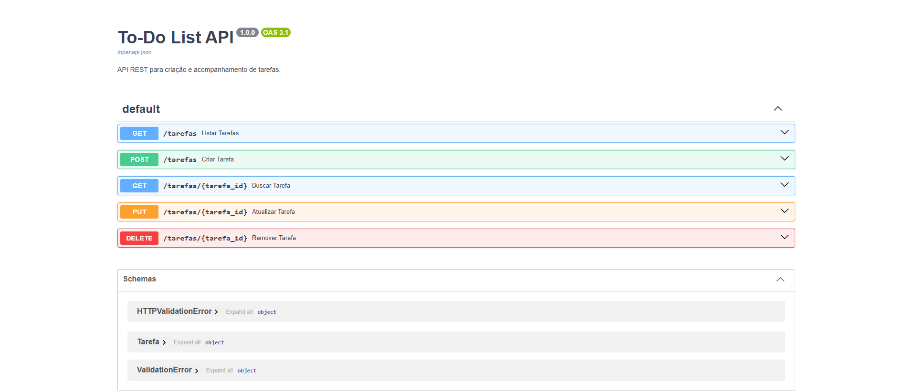

# To-Do List API

API REST para criação e acompanhamento de tarefas, desenvolvida em Python com FastAPI. Permite criar, listar, consultar, atualizar e remover tarefas, com validação dos dados e tratamento de erros.

## Tecnologias
- Python
- FastAPI
- Pydantic (validação de dados)
- Uvicorn (servidor)

## Como rodar

```bash
git clone https://github.com/JotaPekk/todo-list-api.git
cd todo-list-api
python -m venv venv
venv\Scripts\activate
pip install -r requirements.txt
python -m uvicorn main:app --reload
```

A API ficará disponível em `http://127.0.0.1:8000`.

> No Linux/macOS, ative o ambiente com `source venv/bin/activate`.

## Rotas

| Método | Rota | Descrição |
|---|---|---|
| GET | /tarefas | Lista todas as tarefas |
| GET | /tarefas/{id} | Busca uma tarefa pelo id |
| POST | /tarefas | Cria uma nova tarefa |
| PUT | /tarefas/{id} | Atualiza uma tarefa existente |
| DELETE | /tarefas/{id} | Remove uma tarefa |

Ids inexistentes retornam erro 404 e dados inválidos retornam erro 422.

## Documentação

O FastAPI gera automaticamente uma documentação interativa (Swagger). Com o servidor rodando, acesse `http://127.0.0.1:8000/docs` para testar as rotas pelo navegador.



## Próximos passos
- Persistência dos dados com SQLite e SQLAlchemy
- Testes automatizados com pytest
- Novos campos nas tarefas (prazo, prioridade, grupos)